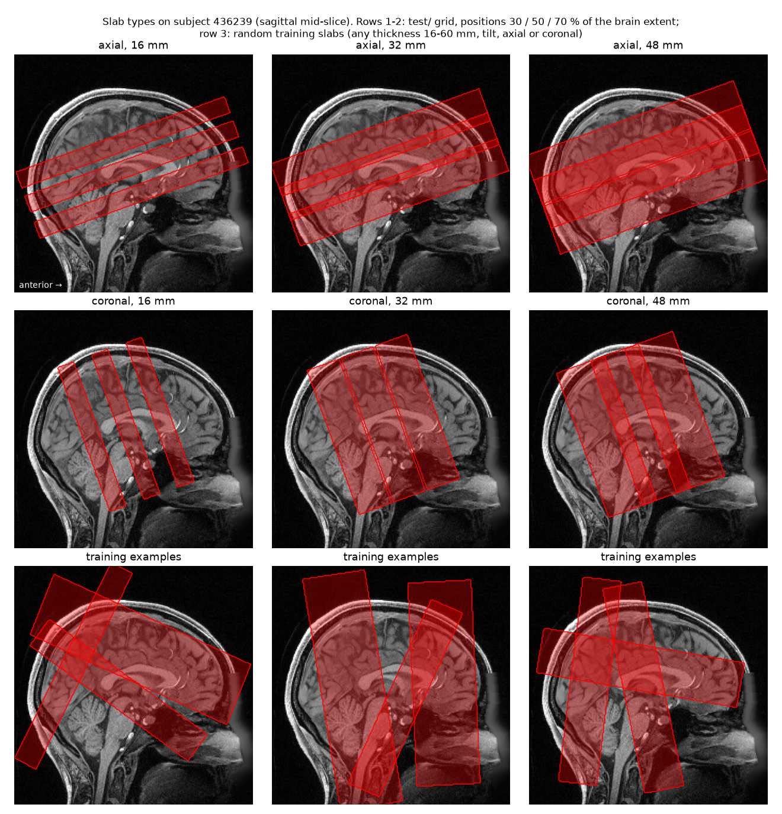

# DLIR partial-FOV: data, slab simulator and baselines

Deep-learning registration (DLIR) of a partial-field-of-view EPI slab to the same subject's T1, including the EPI's
susceptibility distortion. This repository preprocesses raw HCP scans, simulates slabs with exact ground truth,
checks the data, and runs the classical baselines. The best classical method on our validation slabs is AFNI
`align_epi_anat.py` (lpc+ZZ): median error 1.55 mm, 14 % failures.

## Data

- **Raw data:** [HCP Young Adult](https://www.humanconnectome.org/study/hcp-young-adult), S1200 release, unprocessed 3T
  scans from the HCP AWS bucket `s3://hcp-openaccess/HCP_1200/<subject>/unprocessed/3T/` (HCP access keys needed).
  Per subject: `T1w_MPR1`, the 4 resting-state runs (SBRef + spin-echo field-map pair each), the task SBRefs used as
  bridge runs, the scan CSV; `scripts/preprocessing/download_hcp.py` fetches exactly these.
- **Preprocessed data:** `dlir_data.tar.gz` (13.8 GB) in the Google Drive folder
  [DLIR_data](https://drive.google.com/drive/folders/1pny7BDfs8UJl5eWC7uaZxxDfNRF8Bka9) (access on request), with its
  SHA-256 in `dlir_data.tar.gz.sha256`. Unpack with `tar -xzf dlir_data.tar.gz`.
- **Subjects:** 300, drawn in seeded random order from the 1,113 subjects with complete raw data; split by subject into
  210 training, 30 validation, 60 test (`splits/`). The test subjects are not in the data package.

## Repository structure
```
├── environment.yml
├── splits/hcp_{train,val,test}.txt          subject IDs
├── scripts/
│   ├── preprocessing/
│   │   ├── download_hcp.py                  raw HCP files from AWS
│   │   ├── prep_subject.py                  per subject: T1, field maps, corrected SBRefs, anchor + anchor QC
│   │   └── run_preprocessing.sh             all subjects, then the gradient-nonlinearity residual per run
│   ├── slabsim/                             the slab simulator (Python package)
│   │   ├── forward.py                       distortion physics and its inversion (ground truth)
│   │   ├── sampling.py, appearance.py       random training slabs: geometry, distortion, motion, appearance
│   │   ├── geometry.py, samples.py          transforms and slab grids; saving/loading a slab with its truth
│   │   ├── evaluation.py, tools.py          error metrics; FSL/ANTs/AFNI matrix conventions
│   │   ├── dataset.py                       data loader for training
│   │   ├── build_testset.py                 real-distortion slabs for validation and test
│   │   └── validate_forward.py              forward model vs real spin-echo images
│   ├── preproc_qc/
│   │   ├── gnl_check.py, gnl_group.py       gradient-nonlinearity warp and its residual per run
│   │   ├── qc_overlays.py                   visual QC sheets: T1 white-matter outline over the aligned EPI
│   │   ├── qc_summary.py                    QC table and statistics
│   │   └── slab_types_figure.py             figure of the slab types
│   └── baselines/
│       ├── run_baselines.py                 classical and zero-shot baselines, scoring
│       ├── run_testset.sh                   per subject: build the slabs, run the baselines
│       └── summarize.py                     result tables and the baseline selection rule
├── qc/
│   ├── preproc/                             qc_runs.csv, qc_summary.txt, forward_check.csv, slab_types.png/.txt
│   └── baselines/                           pilot_summary.txt, val_summary.txt
└── tests/                                   unit tests: physics, inversion, transform conventions
```

## Preprocessed data tree
```
dlir_data/
├── data/<subject>/                          239 subjects: 209 training + 30 validation
│   ├── anat/
│   │   ├── T1.nii.gz                        fixed image: bias-corrected T1, 1 mm, 179 x 224 x 224
│   │   └── T1_mask.nii.gz                   brain mask
│   └── rfMRI_REST{1,2}_{LR,RL}/             879 runs that passed QC (770 training, 109 validation)
│       ├── sbref_corr.nii.gz                distortion-corrected whole-brain EPI (SBRef), 2 mm, 90 x 104 x 72,
│       │                                    in its own scanner space
│       ├── field_hz_sbref.nii.gz            field map (Hz) on the same grid
│       ├── anchor_epi2t1.txt                4 x 4 rigid transform: EPI scanner mm -> T1 scanner mm
│       └── acq.json                         phase-encoding axis and sign, readout time, QC values
└── test/<subject>_<run>/<slab>/             real-distortion slabs of the 30 validation subjects: 30 runs x 36 = 1,080
    ├── slab.nii.gz                          moving image: real distorted slices; its header = start position
    ├── truth.nii.gz                         4D: true T1 position (x, y, z mm) of every slab voxel
    ├── eval_mask.nii.gz                     scored voxels (brain, unambiguous distortion)
    ├── params.json                          slab settings; "run" = its source run in data/
    └── results.json                         baseline scores: TRE mean/median/p95/max (mm), rotation, translation, time
```
- 198 subjects have all 4 runs, 5 have 3, 36 have 2 (mostly day-2 runs excluded for gradient nonlinearity).
- Slab folders are named `t<thickness mm>_p<position %>_<start error>[_cor]`: `t16_p30_small_cor` is a 16 mm
  coronal slab centred at 30 % of the brain's extent, with a small start error.
- `test/` comes from the validation subjects; the held-out test set (59 subjects x 128 slabs) is separate.

## How the data were preprocessed

| Step | What happens | Tool | Output |
|---|---|---|---|
| 1. T1 | bias correction, 1 mm resampling, brain mask, white matter (for BBR) | ANTs N4, SynthStrip, FSL FAST | `anat/` |
| 2. Field map | topup on the spin-echo pair (opposite phase encoding): one field that explains both distortions | FSL topup | field (Hz) per pair |
| 3. Field to the run | the corrected SBRef is aligned to the corrected spin echo (6 DOF); the field's header is moved to the SBRef's head position | FSL FLIRT | `field_hz_sbref` |
| 4. Corrected SBRef | signal pulled back along phase encoding, intensity times the Jacobian; PE sign from the HCP convention (LR -1, RL +1), checked against the data | own code | `sbref_corr` |
| 5. Anchor | boundary-based registration (BBR) of the corrected whole-brain SBRef to the T1 | FSL epi_reg | `anchor_epi2t1.txt` |
| 6. Anchor QC | BBR restarted 4 times from random 2-4 deg / 2-4 mm offsets; all must return within 0.5 mm | FSL FLIRT | `acq.json` |
| 7. Gradient nonlinearity | raw HCP images are not gradient-corrected; the scanner-fixed warp (from 10 subjects) differs between the T1 and EPI head positions; residual after the anchor's rigid part, 95th percentile | ANTs | `acq.json` |
| 8. Field-map check | the field map must reproduce its own spin echoes through our forward model (see Simulator validation) | own code | `acq.json` |

Steps 1-6 run in `prep_subject.py`, step 7 in `gnl_check.py` / `gnl_group.py` (both in `run_preprocessing.sh`), step 8
in `validate_forward.py`. Everything stays in each scan's own scanner space; nothing is resampled to a template.

**Ground truth.** EPI moves each voxel's signal along the phase-encoding (PE) axis by the local field times the
readout time:

    j_encoded = j_true + s * field_Hz(x) * T_readout        (HCP: T_readout = 0.58 ms x 89 = 51.6 ms; s = -1 LR, +1 RL)

so 100 Hz shifts the signal by about 5 voxels (10 mm). The truth of a slab voxel v is `anchor(D^-1(v))`: the
distortion D is inverted line by line along PE with the measured field (`slabsim/forward.py`), then the anchor maps
the undistorted position to the T1. Voxels where the mapping folds (signal pile-up) are marked invalid.

**Inclusion** (`slabsim.dataset.passes_qc`). A run is used if the anchor QC passed, the gradient-nonlinearity residual
is <= 1.0 mm and its field map passes the check (correlation >= 0.9).

## Slab simulator

**Real-distortion slabs (validation and test, `build_testset.py`).** Consecutive slices cut from the real distorted
SBRef: axial along its own slice axis, coronal along its anterior-posterior axis (PE stays in the slab plane). The
image is not simulated; only its truth is computed. The start error is written into the header only, which is
physically exact (as if the head had been elsewhere during the T1). Fixed seed per subject and run.
- validation grid (`test/` in the package): axial/coronal x 16/32/48 mm x 30/50/70 % x small (1-3 deg and mm) / large
  (6-10 deg and mm) start error = 36 slabs per run;
- test grid: axial/coronal x 16/24/32/48 mm x 25/45/65/85 % x scanner header / small / moderate (3-6) / large =
  128 slabs per run.

**Training slabs (`sampling.py`, `dataset.py`).** A new random acquisition is simulated from the corrected SBRef and
the run's real field map, so the truth is exact by construction:

| Setting | Range |
|---|---|
| Orientation | axial or coronal, 50 % each |
| Thickness; centre | 16-60 mm; 15-85 % of the brain's extent along the slab normal |
| Tilt | pitch +-30 deg, roll and yaw +-10 deg |
| Voxel; field of view | 1.6-2.5 mm; 180-220 mm |
| PE axis and polarity | axial: A-P 70 %, L-R 30 %; coronal: S-I 50 %, L-R 50 %; either polarity |
| Distortion (field scale x readout time) | 0.02-0.09 s (HCP 0.052 s; 7T slabs about 0.045-0.08 s) |
| Head motion, T1 -> slab | rotation SD 2.5 deg, translation SD 3 mm |
| Start error in the header | 0-10 deg and 0-10 mm; plus a 10-30 mm shift in 20 % of slabs |
| Slab-specific shim | 0-100 % of the field's second-order part removed over the slab |
| Appearance | edge ramp 0-4 mm, bias field 0-0.3, gamma 0.8-1.25, Rician noise SNR 10-60 |



*Rows 1-2: the 18 slab geometries of the validation grid at their true positions; row 3: random training slabs. The
slabs are oblique because HCP acquired the EPI tilted to the T1.*

**Simulator validation.**
- `tests/`: 12 unit tests (identity, constant and linear fields, head motion, distort -> undistort round trip, FSL
  and ANTs matrix conventions); all pass.
- `validate_forward.py`: re-distorting the topup-corrected spin echo with our model and the measured field (and
  topup's head-motion estimate) raises its correlation with the real image from a median 0.79 to 0.978, for both
  polarities and all 601 HCP field maps; with <= 1 mm head motion between the spin echoes the lowest is 0.956.
  3 field maps stay below 0.9 (0.68-0.85): the head moved 3.3-7.3 mm between the two spin echoes. Their 6 runs (all
  training) are excluded. topup fitted the same model to these images, so this checks our implementation and sign
  convention rather than the field map's accuracy.

## Quality control
From `qc/preproc/qc_summary.txt`; one row per run in `qc/preproc/qc_runs.csv`.

| Check | Result |
|---|---|
| Anchor QC (BBR restart spread) | all 1,200 runs pass; median 0.05 mm, 95th pct 0.12 mm, worst 0.21 mm |
| Visual QC (`qc_overlays.py`) | all 1,200 runs reviewed, no misalignment |
| Gradient-nonlinearity residual | median 0.39 mm, 95th pct 1.21 mm; 106 runs > 1.0 mm excluded |
| PE sign | the data check agrees with the HCP convention in 1,191 / 1,200 runs; in the other 9 the two signs could not be told apart, and the convention is used |
| Field map, strongest 1 % per run | median 87 Hz, 95th pct 109 Hz, worst 139 Hz (orbitofrontal cortex, temporal poles) |
| Scanner header vs anchor | median 7.7 mm, 95th pct 25 mm, worst 57 mm (T1 and EPI from different sessions) |
| Field-map check | 6 runs excluded (3 field maps with 3.3-7.3 mm head motion between the spin echoes) |
| Included runs | training 770 (209 of 210 subjects), validation 109 (30), test 209 (59) |

## Baselines
Median TRE over slabs; failure = rigid part off by > 2 mm or > 2 deg. Validation slabs (`test/`, 1,080 slabs,
30 subjects; `qc/baselines/val_summary.txt`):

| Method | Median TRE, mm (all / axial / coronal) | Failure (all / axial / coronal) | Time per slab |
|---|---|---|---|
| start position (header) | 6.09 / 6.15 / 5.72 | 88 % / 88 % / 87 % | - |
| affine oracle (best affine fit to the truth) | 1.21 / 1.14 / 1.29 | 0 % | - |
| rigid oracle (best rigid fit to the truth) | 1.54 / 1.22 / 1.70 | 0 % | - |
| **AFNI lpc+ZZ** (affine, 12 DOF) | **1.55 / 1.58 / 1.50** | **14 % / 11 % / 17 %** | 109 s |
| FSL epi_reg (BBR) | 1.98 / 1.46 / 2.30 | 33 % / 19 % / 46 % | 40 s |
| BBR via a whole-brain EPI of another run | 2.06 / 1.87 / 2.13 | 26 % / 22 % / 31 % | < 1 s |
| FSL BBR from the header | 2.16 / 1.70 / 2.30 | 37 % / 30 % / 44 % | 37 s |
| ANTs rigid, mutual information | 3.38 / 4.00 / 3.11 | 75 % / 76 % / 74 % | 2 s |

- The oracles are floors: what remains after the best rigid or affine fit is distortion, largest in inferior axial
  and anterior coronal slabs (about 2-2.5 mm), near the sinuses.
- AFNI was chosen on a pilot (10 validation subjects, 180 axial slabs; `qc/baselines/pilot_summary.txt`): no method
  reached <= 10 % failures, so the lowest failure rate decided (AFNI 9 %, 1.52 mm). The 30-subject validation set
  confirms the choice.
- SynthMorph (zero-shot deep learning, pilot slabs): rigid 8.6 mm, joint 13.1 mm, affine 18.0 mm median, 98-99 %
  failures. On whole-brain EPI it reaches 1.0-1.6 mm, so it fails because of the partial field of view.

## Reproduce
Environment: `conda env create -f environment.yml`, FSL 6.0.7, Docker images `freesurfer/synthstrip`,
`afni/afni_make_build`, `freesurfer/synthmorph`.
```bash
cd scripts
python -m pytest ../tests -q                                           # FSLDIR must be set
python preprocessing/download_hcp.py <raw_dir> --n 300                 # subjects.txt in the same seeded order as splits/
bash preprocessing/run_preprocessing.sh <raw_dir> <prep_dir> 8         # about 1 day on 32 threads
python slabsim/validate_forward.py <prep_dir>/*/fmaps/* > ../qc/preproc/forward_check.csv   # also field-map check
python preproc_qc/qc_summary.py <prep_dir> ../splits ../qc/preproc
python preproc_qc/qc_overlays.py <prep_dir> <sheets_dir>               # visual QC sheets
GRID=val  bash baselines/run_testset.sh ../splits/hcp_val.txt  <prep_dir> <val_dir> 8
GRID=full bash baselines/run_testset.sh ../splits/hcp_test.txt <prep_dir> <test_dir> 8
python baselines/summarize.py <val_dir>/*_rfMRI* > ../qc/baselines/val_summary.txt
python preproc_qc/slab_types_figure.py <package_dir> 436239_rfMRI_REST1_LR ../qc/preproc
```
The data package is `<prep_dir>` reduced to the files listed above plus `<val_dir>` as `test/`.

## Using the data for training
Only `numpy`, `scipy` and `nibabel` are needed. With `scripts/` on the Python path:
```python
import numpy as np
from slabsim.dataset import usable_runs, Run
from slabsim.samples import load_sample

runs = usable_runs('dlir_data/data', open('splits/hcp_train.txt').read().split())    # 770 runs
s = Run(runs[0]).sample(np.random.default_rng(0))        # one training slab, generated on the fly (~0.3 s)
# s['image'] moving slab, s['affine'] its header (with start error), s['truth'] true T1 mm per voxel,
# s['brain'] & s['valid'] = loss mask, s['params'] its settings; fixed image: <subject>/anat/T1.nii.gz

image, affine, truth, mask = load_sample('dlir_data/test/436239_rfMRI_REST1_LR/t16_p70_small_cor')
```
A method's error on a slab (TRE) is the mean distance between its estimated and the true T1 position over
`eval_mask`; it succeeds if TRE < 2 mm. A model is scored like the baselines by adding it to `METHODS` in
`scripts/baselines/run_baselines.py` (returning a 4 x 4 transform or a T1 position per voxel).
